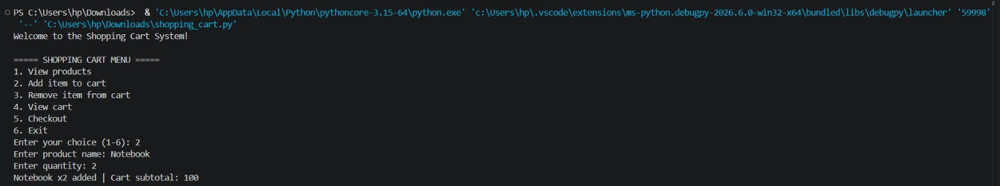
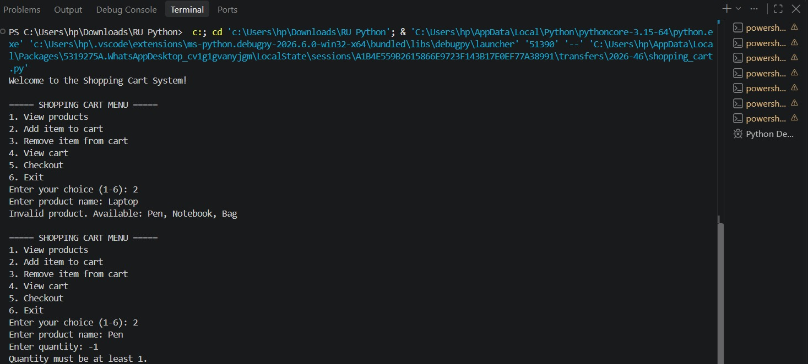
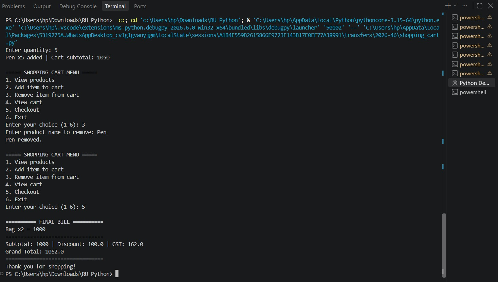

Shopping Cart System 

A simple console-based shopping cart written in Python 3. The user can view products, add or remove items, view the cart, and get a final bill with discount and GST.

1. Problem Statement

Develop a console shopping cart where the user can view products, add or remove items and generate a final bill with discount and GST.

Language: Python 3
Concepts used: Lists, Dictionaries, Functions, Billing

Rules given in the problem:

Item	Value
Pen	Rs. 10
Notebook	Rs. 50
Bag	Rs. 500
GST	18%
Discount	10% only if the subtotal is more than 500
2. Features
View the list of available products with prices
Add an item to the cart (with quantity)
Remove an item from the cart
View the cart with the running subtotal
Checkout and print the final bill (subtotal, discount, GST, grand total)
Input validation for product name and quantity
3. How It Works (Logic)
Products are stored in a dictionary: {"Pen": 10, "Notebook": 50, "Bag": 500}
The cart is also a dictionary: {product name: quantity}
At checkout the program calculates:
Subtotal    = sum of (price x quantity) for every item
Discount    = 10% of Subtotal   (only if Subtotal > 500, else 0)
GST         = 18% of (Subtotal - Discount)
Grand Total = Subtotal - Discount + GST

GST is calculated after the discount is applied.

4. Functions Used
Function	Purpose
show_products()	Prints all products with prices
check_product(name)	Checks if the product exists in the catalogue
check_quantity(text)	Checks that quantity is a whole number and at least 1
calculate_subtotal()	Adds up price x quantity for all items in the cart
add_to_cart()	Takes product and quantity, adds to the cart
remove_from_cart()	Removes a product from the cart
view_cart()	Shows the cart items and subtotal
checkout()	Calculates discount, GST, grand total and prints the bill
show_menu()	Prints the menu options
main()	Runs the menu loop

5. Project Structure
.
├── shopping_cart.py    # main program
└── README.md           # project report

## Project Output

### 1. Add to Cart

### 2. Add to Cart and Checkout

### 3. Invalid Input

### 4. Add to Cart , Remove then Checkout

